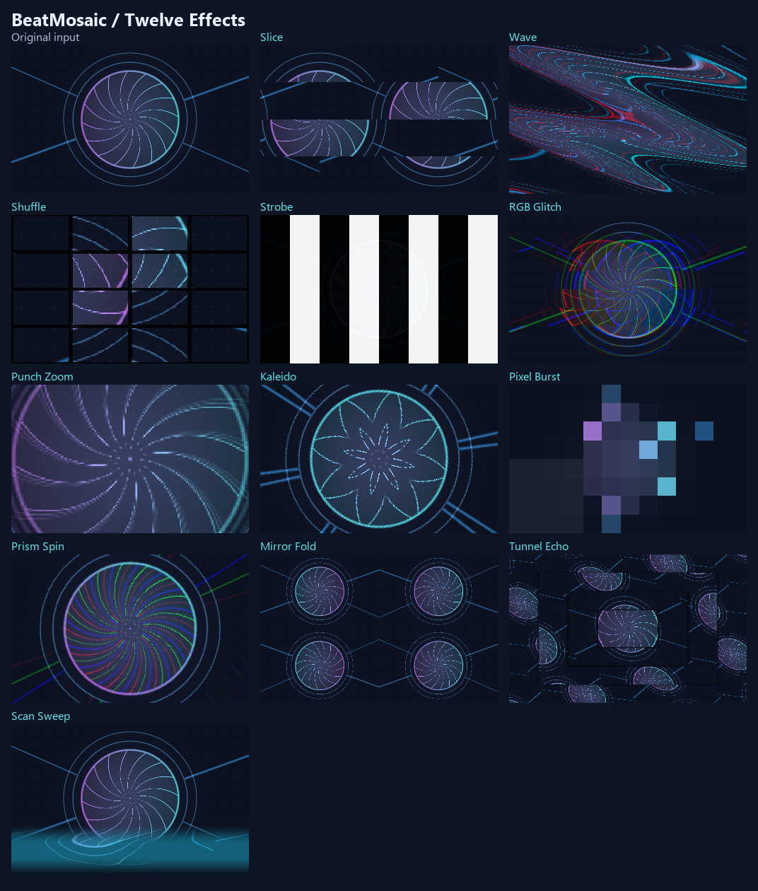

# BeatMosaic for Resolume

BeatMosaic is a Windows x64 FFGL effect for Resolume Arena and Avenue. It applies short visual accents to the clip, layer, or composition you are already playing. Choose audio from the laptop, a sound card, Resolume's FFT controls, the Resolume tempo, or a manual trigger.



## Requirements and installation

- A Windows 10 or later x64 desktop, an OpenGL 4.1-capable graphics driver, and Resolume Arena or Avenue 7.3.1 or later. [FFGL SDK compatibility](https://github.com/resolume/ffgl)
- A video clip or generated source to process. To work with music alone, first put any visual source on the layer you want to animate.

1. [Build the DLL](#build-from-source), then close Resolume.
2. Copy `dist\BeatMosaic.dll` to `Documents\Resolume Arena\Extra Effects` or `Documents\Resolume Avenue\Extra Effects`. Use the **Documents** location shown by File Explorer if Windows redirects it to OneDrive.
3. Reopen Resolume. Search for **BeatMosaic** in **Effects** and drag it onto the active visual clip, its layer, or the composition.
4. In the effect controls, select the audio input and pattern. Set **Input** to **Manual** and press **Hit** for a quick check of the visual effect. [FFGL directories](https://resolume.com/support/en/preferences) · [Resolume effects](https://resolume.com/support/en/effects)

For a custom plugin location, add the folder containing the DLL under **Preferences → Video → FFGL Directories**, then restart Resolume.

## Use YouTube or other laptop audio

1. Choose the intended speakers, headphones, or USB playback device in **Windows Settings → System → Sound → Output**.
2. Play the music in your browser or another application. In Windows Volume Mixer, route that application to the same default output.
3. Set BeatMosaic's **Input** to **Windows Output**. Start with **Pattern** set to **Slice** and **Rate** set to **Every Beat**.
4. Adjust **Sensitivity** until kick or bass accents are picked up consistently. Adjust **Amount** for visual strength and **Decay** for the length of the accent.

Windows Output analyzes the shared audio mix from the default Windows playback device via WASAPI loopback. This includes other audible applications on the same device. [Microsoft WASAPI loopback](https://learn.microsoft.com/en-us/windows/win32/coreaudio/loopback-recording)

## Use a sound card, line-in, or mixer feed

1. Connect the feed and select that recording device in **Windows Settings → System → Sound → Input**.
2. Confirm that the Windows input meter moves when music plays.
3. Set BeatMosaic's **Input** to **Windows Input**. It reads the default Windows recording device, so the selected device needs to expose a Windows recording endpoint. [Microsoft audio capture](https://learn.microsoft.com/en-us/windows/win32/coreaudio/capturing-a-stream)

### Use the audio input configured in Resolume

1. Open **Preferences → Audio**. Select the input device and the channels for **External Audio FFT**.
2. Set BeatMosaic's **Input** to **Resolume FFT**.
3. Open the parameter menu next to **Audio Level** and select **External FFT**. In the analysis controls, choose **L** for low frequencies. Adjust **Gain** until **Audio Level** visibly follows the music, then set BeatMosaic's **Sensitivity**. For audio playing in Resolume itself, **Composition FFT** can drive the same parameter. [Resolume audio preferences](https://resolume.com/support/en/preferences) · [Resolume audio analysis](https://resolume.com/support/en/parameter-animation#audio-analysis)

The Windows input modes detect transients in the bass range. **Resolume FFT** reacts to changes in the band selected for **Audio Level**. In these modes, **Rate** counts detected accents, so soft attacks and sparse bass can produce a different rhythm from the track's beat grid. Use **Resolume BPM** to follow the host's beat grid and align it with **Tap** and **Resync**. [Resolume BPM](https://resolume.com/support/en/bpm)

## Effect controls

| Control | Default | Behavior |
| --- | --- | --- |
| **Input** | **Windows Output** | Selects **Windows Output**, **Windows Input**, **Resolume FFT**, **Resolume BPM**, or **Manual**. |
| **Pattern** | **Slice** | Selects any of the twelve effects below, or audio-adaptive **Random**. |
| **Grid** | **4 x 4** | Controls strip, block, sector, or repetition density in the spatial effects. **Punch Zoom**, **Prism Spin**, **Scan Sweep**, and **Strobe** use their own geometry. |
| **Rate** | **Every Beat** | Responds to every detected accent or every second or fourth accent. In **Resolume BPM** mode, the interval uses host beats. |
| **Amount** | `65%` | Sets the base effect strength. At `0%`, the original image passes through. |
| **Brightness** | `100%` | Multiplies the effect strength for every pattern. Range `0–400%`. The shader clamps the combined strength to its maximum, preserving valid colors and alpha. |
| **Sensitivity** | `65%` | Increases or decreases responsiveness to audio accents. |
| **Decay** | `180` ms | Sets how long an accent takes to fade back toward the original frame. Range `80–600` ms. |
| **Audio Level** | `0%` | Receives the FFT level in **Resolume FFT** mode. |
| **Hit** | Button | Triggers one accent. Works in any input mode, including **Manual**. |

| Pattern | Output |
| --- | --- |
| **Slice** | Alternating horizontal strips shift in opposite directions and slide back as the accent decays. |
| **Wave** | A wide wave warps and zooms the image, with a red channel offset that increases with the accent. |
| **Shuffle** | Tiles jump to different positions, flip, and zoom with dark seams, then blend back toward the original image. |
| **Strobe** | Alternating bright and dark shutters create a strong contrast pulse. Shutters alternate direction between hits and preserve the original alpha. Pulses last at most 140 ms and start at least 350 ms apart across fixed and Random modes. |
| **RGB Glitch** | Separates red and blue channels in horizontal bands, with the direction and offset varying on each hit. Preserves the original alpha. |
| **Punch Zoom** | Pulls the image toward the center with a strong zoom and a short radial blur trail. |
| **Kaleido** | Folds the image into mirrored radial sectors with a different orientation on each hit. **Grid** controls sector density. |
| **Pixel Burst** | Breaks the image into chunky, aspect-correct pixel blocks. **Grid** controls the block density. |
| **Prism Spin** | Rotates and zooms the image while splitting red and blue around the center. The spin direction alternates between hits. |
| **Mirror Fold** | Repeats the image in mirrored rectangular cells with a different fold direction on each hit. |
| **Tunnel Echo** | Rearranges the current frame into nested rectangular rings with alternating twist. |
| **Scan Sweep** | Moves a cyan-tinted distortion band across the image during one pulse, alternating between horizontal and vertical sweeps. |
| **Random** | Selects a pattern on each accepted accent and holds it for the entire pulse. Softer accents favor Slice, Wave, Kaleido, Mirror Fold, and Scan Sweep. Stronger accents favor Shuffle, RGB Glitch, Punch Zoom, Pixel Burst, Prism Spin, and Tunnel Echo. Outstanding peaks can select Strobe when its cooldown permits. |

## Run an audio-adaptive set

1. Set **Input** to **Windows Output**, **Windows Input**, or **Resolume FFT**, following the routing instructions above.
2. Select **Pattern → Random**, **Rate → Every Beat**, **Amount → 80%**, **Brightness → 100%**, and **Decay → 250 ms** as a starting point.
3. Play the music and adjust **Sensitivity** until the detected accents match the passages you want to emphasize. Compare the quieter sections and stronger drops.
4. Increase **Amount** toward `100%` for a more pronounced look, or reduce it to keep more of the original image visible. A longer **Decay** extends Wave and Shuffle, while Strobe retains its duration limit.

Random compares each detected accent level with a moving average of recent accents. It varies the choice without immediately repeating a non-Strobe pattern. **Rate** still controls which accents are rendered. With **Manual → Hit** or **Resolume BPM**, Random varies its selection using the trigger sequence because those modes supply timing rather than measured audio intensity.

Strobe produces high-contrast flashes. Check the venue's flashing-light guidance before use. Its internal timing limits apply to this effect instance. [Photosensitivity information](https://www.epilepsy.com/what-is-epilepsy/seizure-triggers/photosensitivity)

To accent a drop manually, select **Manual**, choose **Slice** or **Shuffle**, and press **Hit** on cue. The effect returns to the original visual after the accent. BeatMosaic analyzes audio locally while it renders and keeps only level measurements for the visual response.

## Troubleshooting

| Symptom | What to check |
| --- | --- |
| BeatMosaic is missing in Resolume | Look in **Effects**. Check the x64 DLL's installation folder and restart Resolume. |
| **Hit** works but YouTube does not move the effect | In Windows Volume Mixer, check that the browser uses the default output selected in Windows Sound. Set **Input** to **Windows Output**. |
| The external sound card does not trigger the effect | Check the Windows input meter and the default recording device for **Windows Input**. For an input selected inside Resolume, use **Resolume FFT** and verify **Audio Level** moves. |
| The effect triggers too often or misses kicks | Use **Every Beat** while tuning. Lower **Sensitivity** for extra triggers or raise it for missed accents. For **Resolume FFT**, start with the low-frequency band and check **Gain** and **Fall**. |
| The visual looks unchanged | Trigger the visual clip, enable the effect, and raise **Amount** and the effect's opacity. **Manual → Hit** gives a test pulse without a music feed. |
| The playback device was switched | Set the desired Windows default again. BeatMosaic checks for endpoint changes and reconnects. |

## Build from source

Install Visual Studio 2022 with **Desktop development with C++**, the Windows SDK, and CMake 3.21 or later. From the repository root, run the following in PowerShell.

```powershell
.\BeatMosaic\build.ps1
```

From the `BeatMosaic` directory, run `.\build.ps1`. The script downloads the pinned FFGL SDK when its cache is empty, verifies the archive checksum, and writes `dist\BeatMosaic.dll`. Keep the notice alongside the DLL when distributing it. [Build script](build.ps1) · [Third-party notices](THIRD-PARTY-NOTICES.txt)

## Verification

Standalone FFGL/OpenGL tests verified all twelve effects, Random coverage of the added effects and strong-accent selection, exact passthrough on padded textures, premultiplied alpha at maximum brightness, portrait rendering, manual triggers and decay, Strobe limits, and simulated FFT and host beat input. A separate WASAPI test measured real audio from the default Windows playback device. The recording endpoint was detected by Windows. Live validation of this build's look and timing in Resolume is pending.
