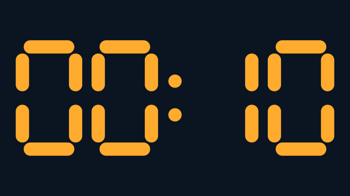

# CueTimer for Resolume

CueTimer is a countdown overlay for stage visuals and event cues. It displays `MM:SS` over a transparent background, so the digits can sit on top of video without covering the rest of the frame.



## Requirements

- Windows x64 and Resolume Arena or Avenue 7.3.1 or later. This is the compatibility target of the pinned Resolume FFGL SDK. [Resolume FFGL SDK](https://github.com/resolume/ffgl)
- A graphics driver that supports OpenGL 4.1 or later. The timer uses a GLSL 4.10 shader.
- To build the DLL, install Visual Studio 2022 with the **Desktop development with C++** workload and a Windows SDK, plus CMake 3.21 or later. The script can find the CMake bundled with Visual Studio.

## Build

Open PowerShell in the `CueTimer` project folder and run the build script.

```powershell
.\build.ps1
```

From the repository root, run `.\CueTimer\build.ps1`. The first uncached build fetches the FFGL SDK from GitHub, verifies the archive's SHA-256, and configures a Windows x64 Release build. Later builds reuse the extracted SDK in `.build`. [Pinned FFGL SDK revision](https://github.com/resolume/ffgl/tree/5b6e07840277df9ec35a228b9eb067636316350f) · [Build script](build.ps1)

The build produces `dist\CueTimer.dll` and `dist\THIRD-PARTY-NOTICES.txt`. Include the notice when sharing a built DLL. [Third-party notices](THIRD-PARTY-NOTICES.txt)

## Install

1. Close Resolume.
2. Copy `dist\CueTimer.dll` into `Documents\Resolume Arena\Extra Effects` for Arena or `Documents\Resolume Avenue\Extra Effects` for Avenue. Use the Documents folder configured for your Windows account and create `Extra Effects` if needed.
3. Reopen Resolume and search for **CueTimer** in **Sources**.

To load the build directly from `dist`, add that folder under **Preferences → Video → FFGL Directories** and restart Resolume. Use one installation location for CueTimer so it is clear which build Resolume loads. [Resolume FFGL directory settings](https://resolume.com/support/en/preferences#ffgl-directories)

## Add the overlay to a composition

1. Keep the video or visuals on a lower layer. Create or select a separate layer above it for the countdown.
2. Drag **CueTimer** from **Sources** to an empty clip slot on the upper layer, then trigger that clip to show the timer in the output.
3. Select the CueTimer clip and use **Transform** in the **Clip** panel to position or scale the digits. Use the clip or layer **Opacity** control to set how prominently they appear.
4. Set **Minutes**, **Seconds**, and **Warning** in the same **Clip** panel, then press **Start** when the cue begins. [Resolume Sources guide](https://resolume.com/support/en/sources)

## Controls

| Control | Default | Behavior |
| --- | --- | --- |
| **Minutes** | `5` | Sets the minute portion from `0` to `99`. Changing it loads the new duration and leaves the timer paused. |
| **Seconds** | `0` | Sets the second portion from `0` to `59`. Changing it also loads the new duration and leaves the timer paused. |
| **Warning** | `10` | Sets the warning threshold from `0` to `59` seconds. The digits turn amber when the positive time remaining reaches or falls below this value. Set it to `0` to disable the amber phase. Changing it leaves the current countdown in place. |
| **Start** | Button | Starts from the configured duration or resumes from the paused time. Press it at `00:00` to start the full duration again. |
| **Pause** | Button | Holds the current time remaining. Press **Start** to continue. |
| **Reset** | Button | Restores the configured duration and leaves the timer paused. Press **Start** when ready. |

The default display is `05:00`. Digits are white above the warning threshold and red at `00:00`, where the countdown stops. Use a positive duration to run the timer. The display rounds the remaining time up to the next whole second.

CueTimer uses elapsed real time while running, independently of clip position and BPM. Use the source's **Start** and **Pause** controls for timing. At zero the timer holds on `00:00`. Cue sequencing follows Resolume's clip settings. When Resolume disconnects the source, CueTimer pauses. If Resolume keeps that instance when you return to the clip, **Start** resumes the held time. A new instance starts paused at the clip's configured duration.

### Example with a 90-second cue

1. Set **Minutes** to `1`, **Seconds** to `30`, and **Warning** to `10`. The overlay shows `01:30`.
2. Press **Start** on cue. Press **Pause** to hold, then **Start** to resume.
3. The display turns amber at `00:10` and red at `00:00`. Press **Reset** to prepare `01:30` again.

### Optional keyboard or MIDI control

With the CueTimer clip selected, open **Shortcuts → Edit Keyboard** or **Shortcuts → Edit MIDI**. If Resolume highlights the CueTimer button you want to assign, select the button and press a key or a control on the MIDI device. Exit shortcut mode and verify that the key or control operates the intended clip. Enable MIDI input for the device under **Preferences → MIDI** when using a controller. [Keyboard shortcuts](https://resolume.com/support/en/keyboard-shortcuts) · [MIDI shortcuts](https://resolume.com/support/en/midi-shortcuts)

## Troubleshooting

| Symptom | What to check |
| --- | --- |
| **CueTimer** is missing from **Sources**. | Confirm the x64 DLL is in the `Extra Effects` folder for the correct Resolume edition or in a configured FFGL directory. Restart Resolume after installing or replacing the DLL. |
| The timer clip is active, but the digits are hidden. | Place CueTimer above the visuals. Check clip and layer opacity, any bypass or solo settings, and whether **Transform** has moved the digits outside the frame. |
| The digits stay at the configured duration. | Press **Start** in CueTimer's controls. Changing **Minutes** or **Seconds**, pressing **Reset**, or disconnecting the source pauses the timer. |
| The timer is red at `00:00` as soon as the clip opens. | Check that **Minutes** or **Seconds** is greater than `0`, then press **Start**. |
| CMake reports a missing toolchain or an SDK download error. | Check the Visual Studio C++ workload, Windows SDK, and CMake version. For an archive checksum error, follow the script's message to remove the named cached archive and run the script again. |

## Verification

A standalone Windows FFGL/OpenGL host checked the default display, start, pause, resume, reset, disconnect behavior, warning and expiry colors, transparency, and portrait rendering. Live verification in Resolume Arena remains pending.
