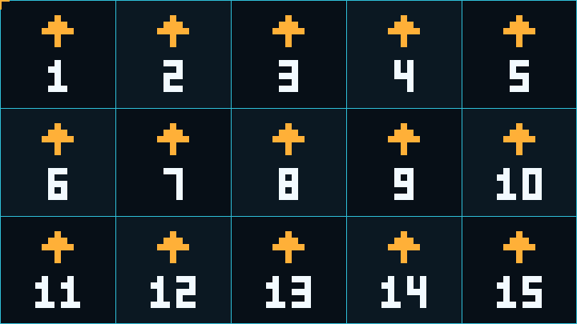

# LEDPanelCheck

LEDPanelCheck is a Windows x64 FFGL video source for Resolume Arena and Avenue. It draws numbered cabinet maps, orientation arrows, and one-pixel test patterns to help check LED wall layouts and pixel mapping.



## Requirements

- Windows x64 and Resolume Arena or Avenue 7.3.1 or later. [Resolume FFGL SDK](https://github.com/resolume/ffgl)
- A graphics driver with OpenGL 4.1 support for the plugin shaders.
- Resolume Arena for the **Output Transformation** steps in the advanced output workflow below. [Output Transformation](https://resolume.com/support/en/output-transformation)

## Install and open the source

1. Obtain `LEDPanelCheck.dll` by [building the plugin](#build-from-source).
2. Close Resolume and copy the DLL to `Documents\Resolume Arena\Extra Effects` or `Documents\Resolume Avenue\Extra Effects`, according to your edition. Use the **Documents** folder shown by File Explorer if Windows redirects it to OneDrive.
3. Reopen Resolume. Search for **LEDPanelCheck** in **Sources**, then drag it to an empty clip slot.
4. Trigger the clip. Use the **Clip** panel to select a pattern and set the cabinet dimensions. [Resolume Sources](https://resolume.com/support/en/sources)

For a custom installation location, add the folder containing the DLL in **Preferences → Video → FFGL Directories** and restart Resolume. [Resolume preferences](https://resolume.com/support/en/preferences#ffgl-directories)

## Controls

| Control | Default | Description |
| --- | --- | --- |
| **Pattern** | **Cabinet Map** | Selects the cabinet map or one of the three one-pixel patterns. |
| **Cabinet W** | `128` | Width of one cabinet in pixels. Accepts whole numbers from `16` to `4096`. Applies to **Cabinet Map**. |
| **Cabinet H** | `128` | Height of one cabinet in pixels. Accepts whole numbers from `16` to `4096`. Applies to **Cabinet Map**. |

| Pattern | Output |
| --- | --- |
| **Cabinet Map** | Numbered cells with cyan borders, upward arrows, and an amber marker at the top-left corner of the render area. |
| **Checker 1px** | Alternating black and white pixels in both directions. |
| **Rows 1px** | Horizontal stripes that alternate black and white every row. |
| **Columns 1px** | Vertical stripes that alternate black and white every column. |

The three pixel patterns are opaque, and the upper-left pixel of the source render area is white. The patterns follow the dimensions of the active render viewport.

## Check the cabinet layout

1. Set **Pattern** to **Cabinet Map**.
2. Enter the pixel width and height of one physical cabinet, such as `128 × 128`.
3. Read the numbers from left to right, starting at `1` in the upper-left corner. The next row continues the sequence. Use the amber corner marker and arrows to check the mapped origin and orientation.

For a wall with five columns and three rows of `128 × 128` cabinets, set **Composition → Settings → Size** to `640 × 384` and set both cabinet dimensions to `128`. With a clip rendered at the composition size, the first row should read `1` through `5`, the second `6` through `10`, and the third `11` through `15`.

When the canvas ends partway through a cabinet, the right or bottom edge can contain partial cells. Their grid lines and fills remain visible, while labels and arrows appear only if they fit in the visible area.

## Check one-to-one pixel mapping

The plugin generates each stripe or square in the source framebuffer. For one-to-one testing on the wall, preserve that resolution through the clip, composition, output, and LED processor.

1. In **Composition → Settings**, set the composition **Size** to the pixel dimensions of the LED canvas you want to test. [Composition settings](https://resolume.com/support/en/composition)
2. Solo the LEDPanelCheck layer, set the clip and layer to full opacity, and keep clip scaling at `100%`. Bypass effects and transforms that could alter the test pattern.
3. In Arena **Advanced Output**, select the output connected to the LED processor. In **Input Selection**, set the slice to the exact source rectangle at whole-pixel coordinates. In **Output Transformation**, place the slice at its intended whole-pixel position, keeping the input and output dimensions equal and using an unwarped rectangle. [Input Selection](https://resolume.com/support/en/input-selection) · [Output Transformation](https://resolume.com/support/en/output-transformation)
4. Configure the LED processor to map the incoming pixels directly to the wall. Confirm that the intended LED region receives the full test pattern at its native resolution.
5. Cycle through **Checker 1px**, **Rows 1px**, and **Columns 1px**. Inspect the actual wall for crisp alternating pixels and consistent spacing across cabinet boundaries. A scaled software preview may visually blend the pattern even when the physical mapping is correct.

For a direct display output, use the same resolution and 1:1 mapping principles without the Arena slice steps. [Resolume output setup](https://resolume.com/support/en/output-setup)

## Troubleshooting

| Symptom | What to check |
| --- | --- |
| LEDPanelCheck is missing from **Sources** | Verify the DLL is in the `Extra Effects` folder for the edition you opened, or add its folder in **FFGL Directories**. Restart Resolume after changing the DLL or its location. |
| The grid shows unexpected cabinet sizes or IDs | Verify that **Cabinet W** and **Cabinet H** are entered in pixels. Check the composition and clip render dimensions, then look for resizing, cropping, or rearrangement in the output path. |
| A partial cell shows only its border and fill | The visible area of that cell may be too small for the annotation. Check whether the canvas dimensions are whole multiples of the cabinet width and height. |
| Stripes look doubled, blurred, or uneven on the wall | Check the clip and composition scales, slice positions and sizes, and LED processor scaling. Compare the row and column tests to isolate the affected axis. |
| The top-left pixel of a cropped slice is black | Pattern parity starts at the source viewport origin. An odd starting row flips **Rows 1px**, an odd starting column flips **Columns 1px**, and an odd sum of the two offsets flips **Checker 1px**. |

## Build from source

Install Visual Studio 2022 with the **Desktop development with C++** workload, MSVC x64 tools, and a Windows SDK. Use CMake 3.21 or newer, either on `PATH` or from the Visual Studio installation.

Run this command in PowerShell from the repository root.

```powershell
.\LEDPanelCheck\build.ps1
```

From the `LEDPanelCheck` project folder, run `.\build.ps1`. The first build downloads and verifies the pinned [Resolume FFGL SDK archive](https://github.com/resolume/ffgl/tree/5b6e07840277df9ec35a228b9eb067636316350f), then configures and builds the x64 Release target. Subsequent builds can reuse the SDK in `.build`.

The script writes `dist\LEDPanelCheck.dll` and `dist\THIRD-PARTY-NOTICES.txt` inside the project folder. Keep the [third-party notices](THIRD-PARTY-NOTICES.txt) with the DLL when distributing it. If the cached SDK archive fails its checksum check, remove that ZIP from the project’s `.build` directory and run the script again.

## Verification

A standalone Windows FFGL/OpenGL smoke test verified plugin loading, parameter defaults and limits, cabinet numbering and arrows, partial cells, and exact pixel output for all three diagnostic patterns at different viewport sizes and offsets. The preview above was rendered with the plugin. Verification inside Resolume and on a physical LED wall is pending.
