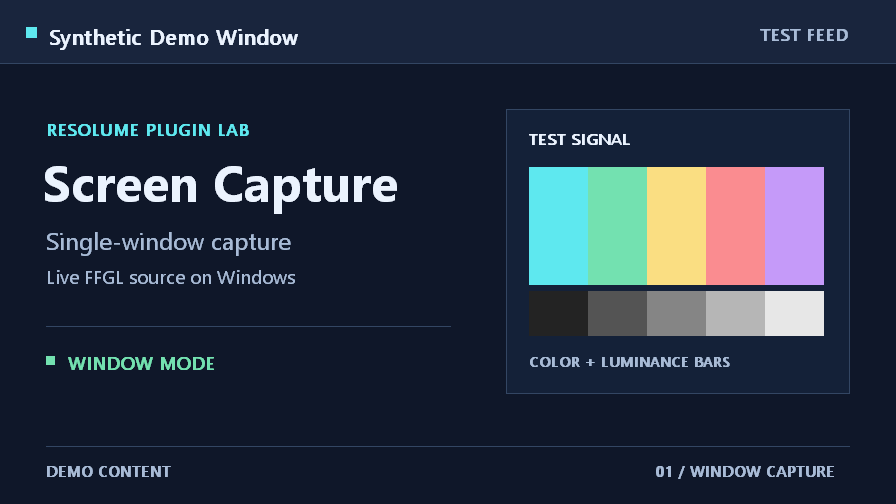
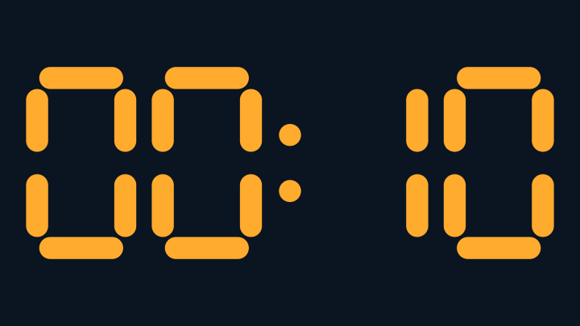
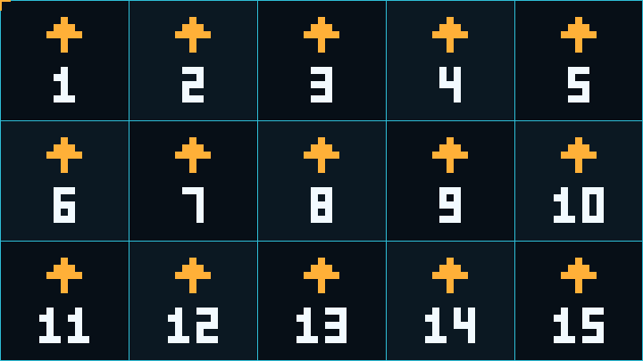
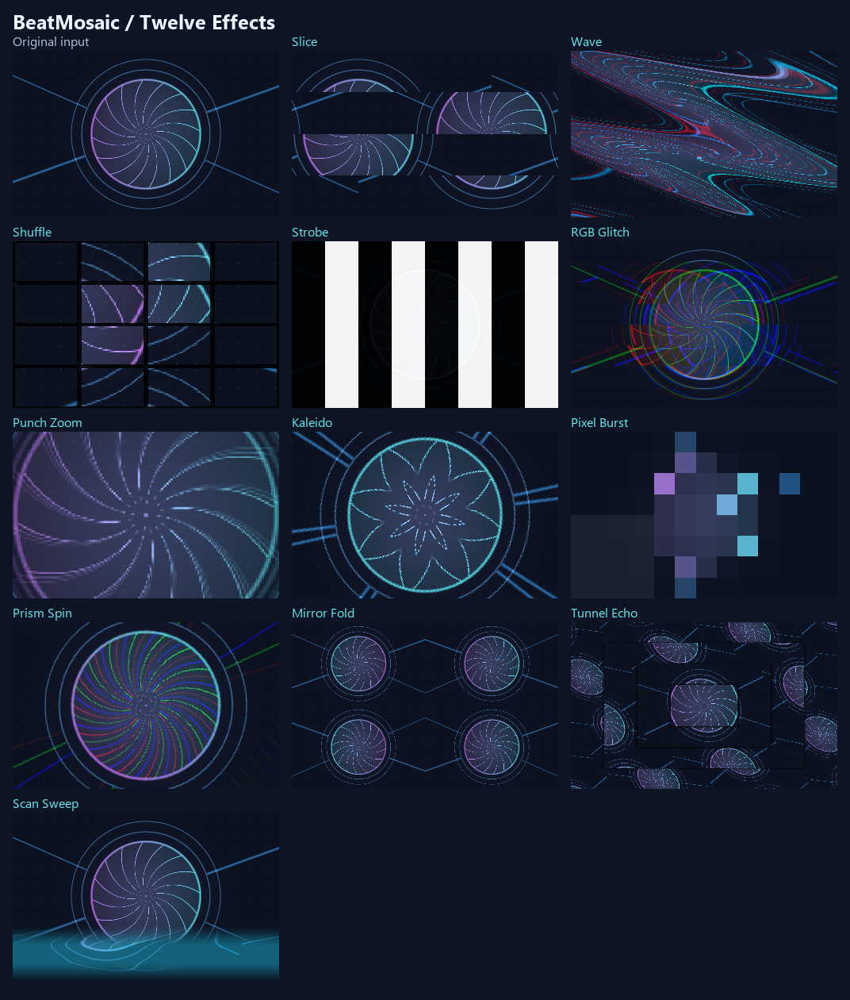

# Resolume FFGL Plugins

Windows x64 FFGL video sources and effects for Resolume Arena and Avenue. Each plugin is an independent C++17 project with its own build script and operating guide.

[Build on Windows](#build-on-windows) · [Install and load a plugin](#install-and-load-a-plugin) · [Troubleshooting](#troubleshooting)

## Screen Capture

Bring a Windows monitor or an individual application window into a Resolume layer. The **Window** menu lists open applications and can be refreshed from the clip panel. The plugin fits the captured image to the viewport and leaves the unused area transparent.



Monitor capture uses Win32 GDI. Window capture uses Windows Graphics Capture and Direct3D 11. Both modes upload frames to an OpenGL texture. [Usage and build guide](ScreenCapture/README.md) · [Source code](ScreenCapture/src)

## CueTimer

A transparent `MM:SS` countdown overlay with **Start**, **Pause**, and **Reset** controls. The digits turn amber at the configurable warning threshold and red when the timer reaches zero.



The countdown uses a monotonic clock. A GLSL shader draws the digits at the correct aspect ratio for landscape and portrait layouts. [Usage and build guide](CueTimer/README.md) · [Source code](CueTimer/src)

## LEDPanelCheck

A test source for LED-wall setup. **Cabinet Map** draws row-major cabinet numbers, orientation arrows, and cabinet boundaries. Three diagnostic modes generate one-pixel checkerboards, rows, and columns.



The shader uses integer framebuffer coordinates to keep the patterns aligned after a viewport resize. For physical LED tests, preserve 1:1 mapping through Resolume and the LED processor. [Usage and build guide](LEDPanelCheck/README.md) · [Source code](LEDPanelCheck/src)

## BeatMosaic

An audio-reactive effect for live VJ visuals with twelve patterns, including **Slice**, **Wave**, **Shuffle**, **Strobe**, **RGB Glitch**, **Punch Zoom**, **Kaleido**, **Pixel Burst**, **Prism Spin**, **Mirror Fold**, **Tunnel Echo**, and **Scan Sweep**. **Random** varies the pattern according to the strength of detected accents. It can follow the default Windows playback or recording device, Resolume FFT, or the Resolume beat grid. **Hit** provides a manual accent.



[Usage and build guide](BeatMosaic/README.md) · [Source code](BeatMosaic/src)

## LyricsDisplay

A synchronized one-line lyric overlay for Resolume. It reads local `.LRC` files and can
optionally query LRCLIB using an artist/title file, while keeping local lyrics available
as a fallback. [Usage and build guide](LyricsDisplay/README.md) · [Source code](LyricsDisplay/src)

## KineticTypography

A custom audio-reactive kinetic typography source with Typewriter, Wave, Bounce, and
Scatter animation modes. It reads UTF-8 text locally and exposes live Trigger, speed,
amount, font size, and hue controls. [Usage and build guide](KineticTypography/README.md) ·
[Source code](KineticTypography/src)

## Build on Windows

The plugins target 64-bit Windows and Resolume Arena or Avenue 7.3.1 or later, with an OpenGL 4.1-capable graphics driver. For Screen Capture's **Window** mode, use Windows 10 version 1903 or later and Resolume 7.4.1 or later for the refreshable window menu. [Resolume system requirements](https://resolume.com/support/tech-specs) · [FFGL SDK compatibility](https://github.com/resolume/ffgl) · [Windows capture requirements](https://learn.microsoft.com/en-us/windows/win32/api/windows.graphics.capture.interop/nf-windows-graphics-capture-interop-igraphicscaptureiteminterop-createforwindow)

Install Visual Studio 2022 with the **Desktop development with C++** workload and the Windows SDK. Use CMake 3.21 or later. The scripts look for CMake on `PATH` and then for a copy bundled with Visual Studio 2022. [CMake Visual Studio 2022 generator](https://cmake.org/cmake/help/latest/generator/Visual%20Studio%2017%202022.html)

Run the script for the plugin you want to build from the repository root.

```powershell
.\ScreenCapture\build.ps1
.\CueTimer\build.ps1
.\LEDPanelCheck\build.ps1
.\BeatMosaic\build.ps1
.\LyricsDisplay\build.ps1
.\KineticTypography\build.ps1
```

Each script downloads the same [pinned Resolume FFGL SDK](https://github.com/resolume/ffgl/tree/5b6e07840277df9ec35a228b9eb067636316350f) when its local cache is empty, verifies the archive's SHA-256, and builds an x64 Release DLL. The first uncached build needs access to `codeload.github.com`.

| Plugin | Build output |
| --- | --- |
| Screen Capture | `ScreenCapture\dist\ScreenCapture.dll` |
| CueTimer | `CueTimer\dist\CueTimer.dll` |
| LEDPanelCheck | `LEDPanelCheck\dist\LEDPanelCheck.dll` |
| BeatMosaic | `BeatMosaic\dist\BeatMosaic.dll` |
| LyricsDisplay | `LyricsDisplay\dist\LyricsDisplay.dll` |
| KineticTypography | `KineticTypography\dist\KineticTypography.dll` |

Each `dist` folder also contains its `THIRD-PARTY-NOTICES.txt`. Keep that file with the DLL when distributing a build.

## Install and load a plugin

1. Build the plugin you want and locate its DLL in the table above.
2. Close Resolume. Open **Documents** in File Explorer and copy the DLL to `Resolume Arena\Extra Effects` or `Resolume Avenue\Extra Effects`, depending on your edition. Create **Extra Effects** if needed. Use the Documents location shown by Windows if the folder is redirected to OneDrive.
3. Open Resolume. Drag **Screen Capture**, **CueTimer**, **LEDPanelCheck**, **KineticTypography**, or **LyricsDisplay** from **Sources** to an empty clip slot. For **BeatMosaic**, drag it from **Effects** onto an existing visual clip, layer, or composition.
4. Trigger the visual clip and adjust the plugin in its clip or effect panel. Follow the linked project guide for its full workflow.

To load plugins from another directory, add the directory in **Preferences → Video → FFGL Directories** and restart Resolume. To update or uninstall a plugin, close Resolume and replace or remove its DLL from the scanned directory before relaunching. [Resolume user folders](https://resolume.com/support/en/directory-list) · [FFGL directories](https://resolume.com/support/en/preferences) · [Sources](https://resolume.com/support/en/sources) · [Effects](https://resolume.com/support/en/effects)

For KineticTypography and LyricsDisplay, create the configuration folders described in their project guides and copy the sample files from each project's `examples` directory as needed. Preserve existing personal text and lyrics when updating. Configuration follows the actual Windows Documents folder, including OneDrive. See each project guide for text editing, LRC timing, online lookup, manual controls, and verification steps.

## Troubleshooting

| Symptom | What to check |
| --- | --- |
| The build script cannot find CMake or the compiler | Check for Visual Studio 2022's **Desktop development with C++** workload, the Windows SDK, and CMake 3.21 or later. |
| The SDK download fails | Check that the build machine can reach `codeload.github.com`, then rerun the script. |
| The SDK archive checksum does not match | Remove the downloaded archive at the path reported by the script, then rerun it to download and verify a fresh copy. |
| The plugin is missing after restart | Confirm that the x64 DLL is in the folder for your Resolume edition or in a configured FFGL directory. Search **Effects** for BeatMosaic or **Sources** for the other plugins. |
| The build cannot overwrite the DLL | Close Resolume if it is loading the DLL directly from `dist`, then rebuild. |

For plugin-specific symptoms, see [Screen Capture](ScreenCapture/README.md#troubleshooting), [CueTimer](CueTimer/README.md#troubleshooting), [LEDPanelCheck](LEDPanelCheck/README.md#troubleshooting), [BeatMosaic](BeatMosaic/README.md#troubleshooting), [LyricsDisplay](LyricsDisplay/README.md), or [KineticTypography](KineticTypography/README.md).

## Verification

The previews come from plugin output rendered in standalone FFGL/OpenGL hosts. The tests covered window switching and resize, timer controls and transparency, exact one-pixel output and cabinet numbering, and BeatMosaic rendering and simulated triggers. Windows playback loopback was also verified separately. KineticTypography and LyricsDisplay were additionally verified in Resolume Arena 7.28, including visible text output and lyric Start/Stop controls. Live verification of the other plugins and testing on a physical LED wall remain pending.

Third-party notices are available alongside each project. [Screen Capture](ScreenCapture/THIRD-PARTY-NOTICES.txt) · [CueTimer](CueTimer/THIRD-PARTY-NOTICES.txt) · [LEDPanelCheck](LEDPanelCheck/THIRD-PARTY-NOTICES.txt) · [BeatMosaic](BeatMosaic/THIRD-PARTY-NOTICES.txt) · [KineticTypography](KineticTypography/THIRD-PARTY-NOTICES.txt) · [LyricsDisplay](LyricsDisplay/THIRD-PARTY-NOTICES.txt)

## Repository hygiene

Commit source code, CMake files, build scripts, documentation, notices, and the publishable sample files under each project's `examples` directory. Keep documentation images under `docs/images`.

The root `.gitignore` excludes downloaded SDKs and generated files in `.build`, `build`, `out`, `dist`, and CMake build directories, along with compiled binaries, editor settings, logs, temporary files, and common credential files. Personal plugin configuration placed directly in a project folder is also ignored; the checked-in examples remain available to new users. Keep private portable configuration under `.local` if you store it inside this checkout.

Before committing, inspect `git status --short`, run `git diff --check`, and review the staged diff with `git diff --cached`. Distribute compiled DLLs as release downloads with their notices instead of adding build output to the source repository.
