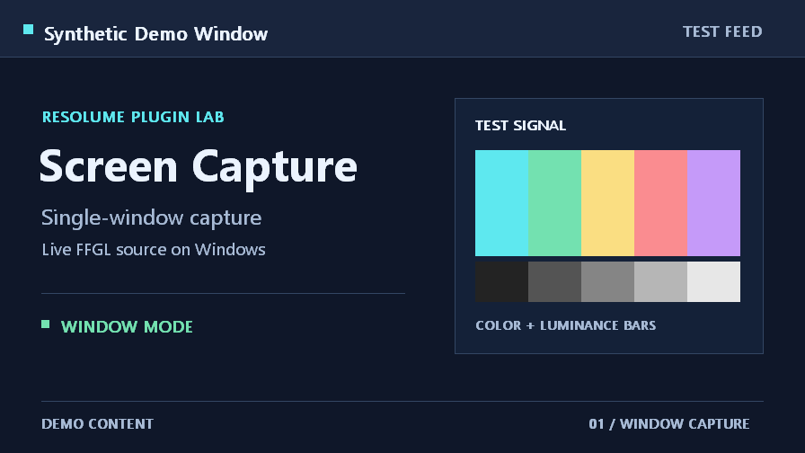

# Screen Capture for Resolume

Screen Capture brings a Windows monitor or an application window into a Resolume Arena or Avenue composition as a live video source. Use **Monitor** mode to show the entire display, or **Window** mode to keep the output on a single application while working in other windows.



## Requirements

- A 64-bit Windows desktop supported by your version of Resolume and an OpenGL 4.1-capable graphics driver.
- **Monitor** mode targets Resolume Arena or Avenue 7.3.1 and later. The monitor capture code uses DPI APIs available from Windows 10 version 1607. [Resolume FFGL SDK](https://github.com/resolume/ffgl/blob/5b6e07840277df9ec35a228b9eb067636316350f/README.md) · [Windows DPI API](https://learn.microsoft.com/en-us/windows/win32/api/winuser/nf-winuser-setthreaddpiawarenesscontext)
- **Window** mode requires Windows 10 version 1903 or later and Resolume 7.4.1 or later for the dynamic window list. Windows Graphics Capture must be available in the desktop session. [Windows Graphics Capture](https://learn.microsoft.com/en-us/windows/win32/api/windows.graphics.capture.interop/nf-windows-graphics-capture-interop-igraphicscaptureiteminterop-createforwindow) · [FFGL dynamic options](https://github.com/resolume/ffgl/blob/5b6e07840277df9ec35a228b9eb067636316350f/README.md)

## Install

1. [Build the plugin](#build-from-source) to produce `dist/ScreenCapture.dll`.
2. Close Resolume. Copy the DLL into `Documents\Resolume Arena\Extra Effects` or `Documents\Resolume Avenue\Extra Effects`, depending on your edition. Use the **Documents** folder shown by File Explorer if Windows redirects it to OneDrive. Replace the old DLL when updating.
3. Start Resolume and search for **Screen Capture** in the **Sources** tab. Drag it into an empty clip slot. Click the clip name under the thumbnail to select its settings before triggering it.

For a custom plugin location, add the folder containing the DLL under **Preferences → Video → FFGL Directories**, then restart Resolume. Keep a single copy of the plugin in the scanned directories. [Resolume FFGL directories](https://resolume.com/support/en/preferences#ffgl-directories) · [Resolume Sources](https://resolume.com/support/en/sources) · [Resolume Clips](https://resolume.com/support/en/clips)

## Capture an entire monitor

1. Select the **Screen Capture** clip by its name and open the **Clip** panel.
2. Set **Source** to **Monitor**. Set **Monitor** to **Primary** to follow the Windows main display, or choose a numbered Windows display such as **Display 2**.
3. Click the clip thumbnail to trigger it. Check the output before bringing the layer into your show.

Monitor mode captures everything visible on the selected display, including any Resolume interface or output on that display. If you see a repeated image, move Resolume to another monitor, or switch to **Window** and select the application you want to show.

If a selected display is disconnected, the clip becomes transparent and can recover when that display is available again. If Windows assigns a different display number, select the new entry. Restart Resolume to rebuild the monitor list after adding or reconfiguring displays.

## Capture one application window

1. Open the application and keep its target window restored on the Windows desktop.
2. Select the **Screen Capture** clip by its name. In the **Clip** panel, set **Source** to **Window**. The plugin scans open windows when you switch modes.
3. Choose the application's title in **Window**. If the title is missing or out of date, click **Refresh Windows** and select the window from the updated list.
4. Click the clip thumbnail to trigger it. The capture can continue when another window covers the selected application.

The list contains titled, visible top-level windows from other applications. Resolume windows, untitled windows, and tool windows are excluded. The output becomes transparent while the target is minimized, hidden, or closed. Restore a minimized window to resume capture. After reopening an application or restarting Resolume, refresh the list and select the target again. Windows may draw a capture indicator around the selected window, and protected content can be blank.

## Clip controls

| Control | Default | Behavior |
| --- | --- | --- |
| **Source** | **Monitor** | Switches between a whole display and an individual application window. |
| **Monitor** | **Primary** | Appears in Monitor mode. **Primary** follows the Windows main display. Numbered entries identify the display devices found when the plugin loads. |
| **Window** | **None** | Appears in Window mode. Select a listed title to start capturing it, or select **None** for transparent output. |
| **Refresh Windows** | Button | Appears in Window mode. Rebuilds the window list after applications open, close, or change their titles. An existing selection is preserved when the same target is still listed. |

The source scales the captured image to fit the clip viewport while preserving its aspect ratio. Any unused area stays transparent. Use the clip's standard **Transform**, **Opacity**, or **Blend Mode** controls to position and composite the result. The source provides SDR video only. It checks for frames at intervals of about 33 milliseconds, so the capture can update up to roughly 30 frames per second while Resolume renders the source. [Resolume source properties](https://resolume.com/support/en/sources)

## Troubleshooting

| Symptom | What to check |
| --- | --- |
| **Screen Capture** is missing from **Sources** | Confirm that the x64 DLL is in the plugin folder for the edition you opened, then restart Resolume. If you use a custom folder, check **Preferences → Video → FFGL Directories**. |
| The **Window** menu is empty or stale | Use Resolume 7.4.1 or later, restore the application's main window, and click **Refresh Windows**. |
| The selected window shows no image | Restore or reselect the window. If the window remains blank, try a regular window such as Notepad to check whether Windows Graphics Capture works in the current session. Protected content can be blank even when the window itself is listed. |
| The monitor number or selection changed | Check your active displays in Windows. Restart Resolume to update the list, then select the intended display again. |
| The image repeats inside itself | Move Resolume and its preview away from the selected monitor, or switch to **Window** mode. |
| The background shows through at the sides or top | This is the transparent space left by aspect-ratio fitting. Place a background layer below the clip, or adjust the clip's scale and position. |

## Build from source

Install Visual Studio 2022 with the **Desktop development with C++** workload and a Windows SDK with C++/WinRT headers. Use CMake 3.21 or later. The script checks for CMake on `PATH` and in the Visual Studio installation. [CMake Visual Studio 2022 generator](https://cmake.org/cmake/help/latest/generator/Visual%20Studio%2017%202022.html)

Run the following in PowerShell from the `ScreenCapture` folder.

```powershell
.\build.ps1
```

From the repository root, run `.\ScreenCapture\build.ps1`. The first build downloads the pinned FFGL SDK archive, checks its SHA-256 hash, and caches it in `.build`. The Release build produces `dist/ScreenCapture.dll` and copies `THIRD-PARTY-NOTICES.txt` alongside it. Keep the notice with the DLL when distributing the build. If CMake reports a cache mismatch after moving the project, remove `.build/cmake` from this project and run the script again. [Build script](build.ps1) · [CMake configuration](CMakeLists.txt) · [Third-party notices](THIRD-PARTY-NOTICES.txt)

## Implementation and verification

The monitor backend uses Win32 GDI. The window backend uses Windows Graphics Capture with Direct3D 11. The FFGL source uploads frames to an OpenGL texture and renders the selected input. [Source code](src/)

Standalone FFGL/OpenGL checks covered rendering a synthetic window, switching windows, and resizing the target. The preview above shows the plugin's rendered output from a synthetic test window. Verification inside Resolume is pending.
